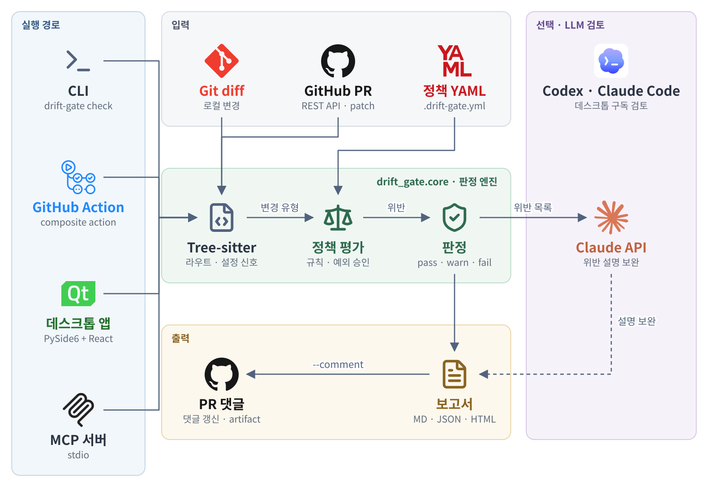

<div align="center">

<h1>
  <picture>
    <source media="(prefers-color-scheme: dark)" srcset="docs/assets/brand/drift-gate-wordmark-dark.png">
    
  </picture>
</h1>

코드가 바뀌었는데 문서가 따라오지 않은 PR을 찾아내는 정책 엔진

[](https://github.com/cres17/pr-convention-checker/actions/workflows/ci.yml?query=branch%3Amain)
[](LICENSE)


</div>

API 경로를 바꿨는데 명세에는 이전 주소가 남아 있거나, 새 환경변수를 쓰는데 `.env.example`에 키가 없는 경우를 PR 단계에서 잡습니다. 팀이 `.drift-gate.yml`에 "이 코드가 바뀌면 이 문서도 바뀌어야 한다"는 규칙을 적으면, 변경 내용을 분석해 필요한 문서의 누락을 판정하고 근거를 보고서로 남깁니다. 같은 엔진을 로컬 CLI, GitHub Actions, 데스크톱 앱, MCP 서버에서 그대로 씁니다.

| 코드 변경 | 확인하는 문서 | 검사 방식 |
|-----------|--------------|----------|
| API 메서드 · 경로 | API 명세 | 추가 · 삭제된 메서드와 경로를 문서 diff와 대조 |
| 환경변수 키 | `.env.example` 등 | 새 키 누락, 코드에서 지운 키의 잔존 확인 |
| DB 스키마 · CI · 인프라 · 인증 | 운영 · 배포 · 보안 문서 | 지정한 문서의 동반 수정 확인 |

통과 · 실패는 규칙 엔진이 결정하고, LLM은 판정 뒤에 설명을 보태는 선택 기능입니다. 검증 기록과 알려진 한계는 [docs](docs)와 [계획](계획.md)에 공개합니다.

## 전체 아키텍처

<p align="center">
  
</p>

| 단계 | 하는 일 | 코드 |
|------|--------|------|
| 입력 | 로컬 Git diff 또는 GitHub PR의 변경 파일 · patch와 정책 YAML을 읽음 | `adapters/git`, `adapters/github`, `core/policy` |
| 신호 추출 | 변경된 코드에서 라우트 · 환경변수 접근 · 공개 선언을 Tree-sitter로 추출, 불완전한 diff는 휴리스틱으로 대체하고 그 사유를 기록 | `adapters/ast` |
| 정책 평가 | `when` 조건에 맞는 규칙의 `require.groups`를 확인하고, 승인된 예외를 CODEOWNERS · 리뷰 승인으로 검증 | `core/classification`, `core/trust` |
| 판정 | 심각도에 따라 pass · warn · fail · 검사 대상 없음을 결정 | `core/gating` |
| 출력 | Markdown · JSON · HTML 보고서, PR 댓글, Action artifact | `reporters`, `adapters/github` |

```text
drift_gate/
├── core/          정책 모델 · 분류 · 판정 · 예외 신뢰 검증 (외부 I/O 없음)
├── adapters/      git · github · ast · cli · github_action · mcp · claude · eval
├── reporters/     markdown · json · html
├── desktop/       PySide6 앱과 React 빌드 결과(web/)
└── tests/         단위 · 통합 테스트와 고정 평가 사례
desktop-ui/        데스크톱 화면 React 소스
examples/          FastAPI · Django · Express · Next.js · Prisma · Actions 배포용 정책 예제
```

## 각 기술 설명

### PyYAML — 정책 파일

`.drift-gate.yml`의 각 규칙은 `when.any_changed`(트리거 경로), `require.groups`(함께 바뀌어야 할 문서 묶음), `severity`, `message`로 이뤄집니다. `core/policy/loader.py`가 파일을 읽고 `validator.py`가 스키마를 검사합니다. 모든 묶음을 만족해야 통과하고, 하나라도 비면 위반입니다. `drift-gate init --preset`으로 프레임워크별 시작 정책을 만들 수 있습니다.

### Tree-sitter

`adapters/ast`에 언어별 어댑터가 있습니다. Python과 TypeScript/JavaScript는 Tree-sitter 문법 트리에서 라우트 데코레이터 · Express 라우트 · 환경변수 접근을 찾고, Go · Java · Kotlin · Ruby는 공개 함수와 타입 선언을 찾습니다. 파서는 `tree-sitter-language-pack`에서 불러오며, 배포본에 넣는 파서 라이브러리는 `parser_hashes.json`의 해시로 확인합니다. 파싱에 실패하거나 diff 조각이 불완전하면 정규식 휴리스틱으로 넘어가고, 어떤 방법을 썼는지 보고서에 표시합니다.

### Git · GitHub REST API

로컬 검사는 `git diff`로 변경 경로와 patch를 모읍니다. PR 검사는 GitHub REST API로 PR 파일 목록과 patch를 받고, 예외 승인은 base 브랜치의 CODEOWNERS와 현재 리뷰 승인을 대조해 확인합니다(`adapters/github/approvals.py`). PR 본문의 `drift-ignore: <rule-id>` 예외는 BLOCKER · MAJOR 규칙이면 사유가 있어야 받아들이고, 승인자 이름만 적은 것은 승인으로 인정하지 않습니다. 결과 댓글은 `<!-- drift-gate-v1 -->` 마커로 기존 댓글을 찾아 갱신합니다.

### CLI · GitHub Actions

`drift-gate check`가 기본 검사이고, `report` · `explain` · `doctor` · `demo` · `holdout` 등의 하위 명령이 있습니다. `action.yml`은 composite action으로 저장소를 pip 설치한 뒤 `drift_gate.adapters.github_action.runner`를 실행해, 판정 결과를 job 상태 · PR 댓글 · artifact로 남깁니다.

### MCP 서버

`drift-gate-mcp`는 외부 SDK 없이 JSON-RPC를 stdio로 주고받는 작은 MCP 서버입니다(`adapters/mcp/server.py`). Claude Code 같은 MCP 클라이언트가 정책 조회와 검사를 도구로 호출할 수 있습니다.

### PySide6 · React — 데스크톱 앱

`drift_gate/desktop/web_app.py`가 PySide6의 Qt WebEngine 창에 React 화면을 띄우고, QWebChannel로 Python 검사 서비스와 화면을 연결합니다. 저장소를 고르면 규칙별 근거와 diff를 보여 주고 보고서를 저장합니다. 화면 소스는 `desktop-ui`(React 19 · Vite · Tailwind CSS · tool-ui 컴포넌트)에 있고, `desktop-build.yml`이 PyInstaller로 Windows · macOS 패키지를 만듭니다.

### Claude API · Codex · Claude Code (선택)

`adapters/claude/enricher.py`는 판정이 끝난 위반 목록을 Claude Messages API에 보내 리뷰어용 체크리스트와 설명을 받습니다. 통과 · 실패 판정에는 관여하지 않으며, API 키가 없으면 건너뜁니다. 데스크톱 앱의 구독 검토(`desktop/subscription_review.py`)는 사용자가 로그인한 Codex CLI 또는 Claude Code를 하위 프로세스로 실행해 추가 의견을 받고, 보내기 전에 전송 내용을 미리 보여 주며 도중에 중지할 수 있습니다.

### pytest · Ruff · mypy · CI

`drift_gate/tests`에 정책 · 어댑터 · 판정 · 보고서 · 데스크톱 서비스 테스트와 고정 평가 사례가 있습니다. `ci.yml`은 Ruff · mypy(core) 검사 job과 별도로 Ubuntu · Windows · macOS × Python 3.10 · 3.11 · 3.12의 9개 조합에서 pytest를 실행하고, `benchmark.yml`은 합성 평가셋의 탐지 결과를, `parser-hashes.yml`은 파서 해시를 확인합니다. 평가셋은 작성자가 만든 합성 사례라 실제 PR 정확도와는 구분해서 봐야 하며, 개선 전후 비교와 남은 오탐 · 미탐은 [`docs/assessment`](docs/assessment)에 원자료와 함께 있습니다.
